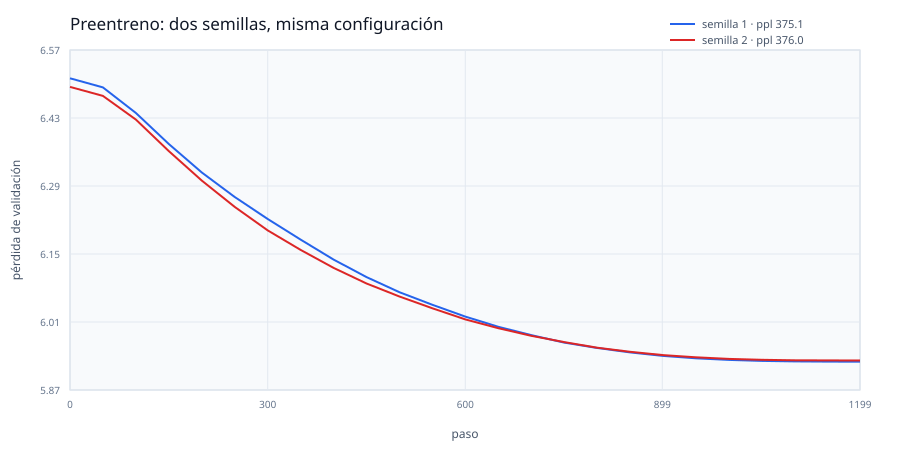

# Informe F6: LLM pequeño

## 1. La puerta

> Informe con curvas y perplejidad, repetición con otra semilla y SFT comparado antes/después.

Este informe reúne las tres piezas con el mismo modelo de **1.401.792 parámetros**.

## 2. Datos y configuración

- **Corpus**: 200.000 caracteres de *Don Quijote de la Mancha* (Gutenberg #2000, dominio público).
- **Split**: 90/10; 78.208 tokens de train y 8.677 de validación con BPE 512 (0,434 tokens/carácter).
- **Modelo**: `d_model=160`, 8 cabezas, 4 bloques, `d_ff=640`, vocabulario 512.
- **Preentreno**: 1200 pasos, contexto 128, `lr_max=0.003`, warmup 100, cosine, clipping 1.0,
  checkpoints cada 200 pasos.

## 3. Curvas y perplejidad



| Semilla | Pérdida val inicial | Pérdida val final | PPL inicial | PPL final |
| --- | --- | --- | --- | --- |
| 1 | 6.5138 | 5.9272 | 674.41 | **375.12** |
| 2 | 6.4960 | 5.9297 | 662.50 | **376.03** |

- Las dos semillas terminan a **0,91 puntos de perplejidad** (0,24 %).
- La pérdida de train final (5.9190 y 5.9917) está cerca de la de validación: **no hay sobreajuste
  fuerte**, pero el modelo está **poco entrenado**.
- La perplejidad baja de ~670 a ~375; el modelo distingue tokens, no escribe frases.

## 4. SFT antes/después

Mismos 16 pares de train y 6 de validación; 300 pasos, `lr=0.0005`, desde el checkpoint del paso 1000.

| Métrica | Antes | Después |
| --- | --- | --- |
| Pérdida de validación | 6.0114 | **5.7564** |
| Perplejidad | 408.05 | **316.20** |

La pérdida baja, pero las muestras siguen siendo fragmentos:

```
antes:   auna os a a a to o iiel o ia a a e útamiiia o os acaballero o o uestro...
después: :úo a a a ta o ieala ea mo pyo ió iee�o que abro o o pro brde i�a...
```

El SFT ajusta el formato/los pares, **no convierte al modelo en un asistente**. Es un resultado
negativo honesto: 16 pares y un preentreno de 1200 pasos no alcanzan.

## 5. Lectura de overfitting

- Train y validación se mueven juntas; no hay una brecha grande.
- El límite no es overfitting, es **capacidad de datos/pasos**: el modelo aún no modela morfología.
- El SFT baja la pérdida en su distribución de 6 pares, no en texto libre.
- Comparar perplejidades de pretrain y SFT no es directo: son distribuciones distintas.

## 6. Reproducción

```
node lab/transformer/pretrain.ts 1 1200
node lab/transformer/pretrain.ts 2 1200
node lab/transformer/plot-seeds.ts
node lab/transformer/sft.ts
```

- Curvas: `data/pretrain-seed-1.json`, `data/pretrain-seed-2.json`.
- SFT: `data/sft-report.json`.
- Checkpoints: `checkpoints/` (no versionados; ~41 MB cada uno).

## 7. Límites

- Modelo de 1,4M y corpus de 200 KB: no es un LLM útil, es un banco de pruebas.
- Sin dropout, sin batch, sin KV cache.
- Una sola arquitectura y un solo corpus.
- La muestra generada no es español legible; el número no debe exagerarse.

## 8. Conclusión

La puerta se cumple: hay **curvas**, **perplejidad**, **dos semillas** y **SFT antes/después**. El
resultado es modesto y está medido: el pipeline funciona de punta a punta, el modelo no.
