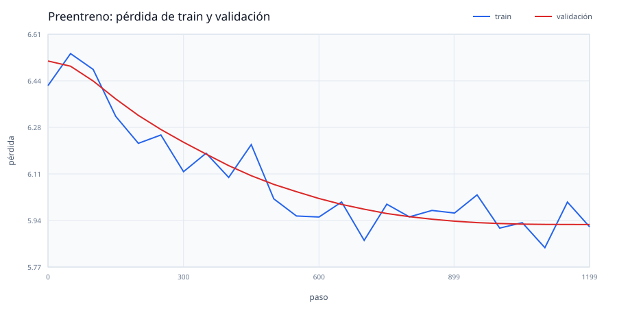

# Preentreno

## 1. Qué problema resuelve

El LM de F6 tiene **1.401.792 parámetros** y se entrena sobre el Quijote tokenizado con BPE. No basta
con bajar la pérdida: hacen falta un **schedule** estable, **recorte de gradientes**, **checkpoints** y
una medida de generalización, la **perplejidad** de validación.

## 2. Definición y notación

- **Paso**: una ventana de 128 tokens de train; se predice cada token a partir del anterior.
- **Warmup + cosine**:

$$ \eta_t = \eta_{\max}\frac{t+1}{T_w} \quad (t < T_w), \qquad
\eta_t = \frac{\eta_{\max}}{2}\left(1+\cos\left(\pi\frac{t-T_w}{T-T_w}\right)\right). $$

- **Gradient clipping**: si $\|g\| > c$, se escala $g \leftarrow g \cdot c / \|g\|$.
- **Perplejidad**: $\mathrm{PPL} = e^{\mathcal{L}}$, con $\mathcal{L}$ la cross-entropy media por token.
- **Checkpoint**: parámetros con nombres + metadatos (semilla, paso, arquitectura, pérdida).

## 3. Por qué funciona

- El warmup evita pasos grandes al principio, cuando los gradientes son ruidosos.
- El cosine baja la tasa al final para afinar.
- El clipping evita que una ventana con gradiente enorme desestabilice el modelo.
- La perplejidad de validación separa aprender de memorizar.
- El checkpoint permite reanudar y comparar sin repetir todo.

## 4. Ejemplo y presupuesto

- Corpus: 78.208 tokens de train y 8.677 de validación (BPE 512).
- Modelo: `d_model=160`, 8 cabezas, 4 bloques, `d_ff=640`.
- 1200 pasos, contexto 128, batch 1.
- `lr_max=0.003`, warmup 100, clipping 1.0.
- Checkpoint cada 200 pasos; evaluación cada 50.

Resultados (semilla 1):

| Métrica | Inicio | Final |
| --- | --- | --- |
| Pérdida de validación | 6.5138 | **5.9272** |
| Perplejidad | 674.41 | **375.12** |
| Pérdida de train (paso 1199) | 6.4255 | 5.9190 |

- 25 puntos de evaluación (cada 50 pasos), 1200 pasos, 1.401.792 parámetros.
- Checkpoints en los pasos 200, 400, 600, 800 y 1000; cada uno pesa ~41 MB y no se versiona.
- La perplejidad baja de 674 a 375, pero sigue siendo alta: el modelo distingue tokens, no escribe
  español. La muestra generada son fragmentos de bytes, no frases.

## 5. Implementación

- [`lab/transformer/pretrain.ts`](../../lab/transformer/pretrain.ts): bucle, schedule, clipping,
  evaluación y checkpoints.
- [`src/optim/clip.ts`](../../src/optim/clip.ts): `clipGradients`.
- [`src/optim/sgd.ts`](../../src/optim/sgd.ts): tasa de aprendizaje mutable para el schedule.
- [`src/models/transformer-lm.ts`](../../src/models/transformer-lm.ts): `namedParameters` para el
  checkpoint.
- [`src/io/checkpoint.ts`](../../src/io/checkpoint.ts): guardado JSON.

## 6. Verificación

- `clipGradients` recorta la norma global y no toca una norma pequeña.
- La tasa de aprendizaje se puede cambiar y rechaza valores inválidos.
- Los nombres de parámetros cubren todos los tensores.
- 167/167 pruebas y `verify.mjs` en verde.
- La corrida deja `data/pretrain-seed-1.json` con las 25 curvas y checkpoints reanudables.

## 7. Límites y errores comunes

- **Una sola ventana por paso**: gradiente ruidoso; no hay batch.
- **1200 pasos** no son un preentreno grande.
- **Perplejidad alta** no significa que el código falle; el corpus y el modelo son pequeños.
- **Checkpoints** ocupan ~41 MB cada uno; no se versionan.
- **Sin dropout** todavía; el informe de overfitting lo medirá.
- **La muestra es pobre** (fragmentos de bytes): el modelo aún no aprendió morfología.

## 8. Mi explicación

Pendiente: la escribe la persona, sin mirar el resto de la nota.

## 9. Para profundizar (opcional)

- Loshchilov y Hutter (2017), *SGDR: Stochastic Gradient Descent with Warm Restarts*.
- Pascanu et al. (2013), *On the difficulty of training recurrent neural networks* (clipping).
- Kaplan et al. (2020), *Scaling Laws for Neural Language Models*.
