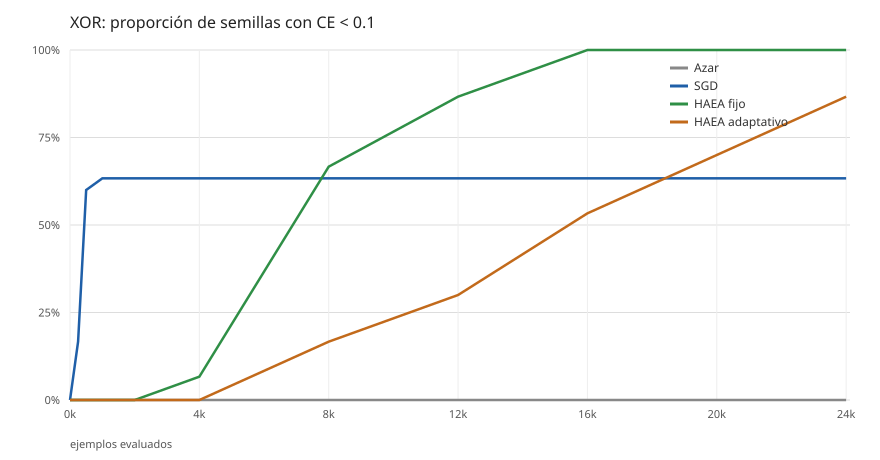

# Evolución vs gradiente

## 1. Qué problema resuelve

¿Cuándo conviene evolucionar y cuándo usar el gradiente? La pregunta no se responde con una opinión:
hace falta el mismo problema, la misma arquitectura y el mismo presupuesto de evaluaciones. Aquí se
compara el azar, HAEA y SGD en XOR.

## 2. Definición y protocolo

- **Problema**: XOR, red `2 → 4 ReLU → 2` con 22 parámetros.
- **Fitness**: cross-entropy sobre las cuatro filas (minimizar).
- **Presupuesto**: 24.120 ejemplos por método.
  - HAEA: 30 individuos × 201 evaluaciones × 4 ejemplos.
  - SGD: 6.030 pasos × 4 ejemplos.
  - Azar: 6.030 genomas aleatorios × 4 ejemplos (control).
- **Semillas**: 30 por método.
- **Éxito**: acertar 4/4.
- **Umbral**: CE < 0.1; se cuentan los ejemplos hasta alcanzarlo.
- **Ablación**: HAEA adaptativo (premia/castiga operadores) contra HAEA con tasas fijas.

## 3. Por qué así

- Comparar por **ejemplos evaluados**, no por generaciones o pasos: cada evaluación cuesta lo mismo.
- Misma red y mismos datos para los cuatro métodos.
- La semilla se repite para que la diferencia no sea un golpe de suerte.
- El umbral CE < 0.1 separa «acertar por poco» de «estar seguro».
- El **azar** es el control que dice si la evolución aporta algo más que muestrear.

## 4. Resultado con 30 semillas

| Método | Éxito (4/4) | CE < 0.1 | Ejemplos (mediana) | CE final (media ± sd) | Exactitud |
| --- | --- | --- | --- | --- | --- |
| Azar | 2/30 | 0/30 | 24.120 (tope) | 0.6420 ± 0.0089 | 0.68 |
| SGD `lr=0.5` | 19/30 | 19/30 | 396 | 0.1765 ± 0.2418 | 0.89 |
| HAEA fijo | 30/30 | 30/30 | 6.300 | 0.0013 ± 0.0035 | 1.00 |
| HAEA adaptativo | 30/30 | 26/30 | 15.900 | 0.0522 ± 0.0805 | 1.00 |

Lectura:

- **El azar no basta**: 2/30 aciertos por casualidad y 0/30 con CE < 0.1. La evolución no es muestrear.
- **El gradiente es mucho más eficiente en muestras**: cuando converge, necesita ~396 ejemplos de
  mediana frente a ~6.300 del HAEA fijo (unas 16 veces menos). Pero se queda en 19/30: en este
  presupuesto y con `lr=0.5`, once semillas no llegan.
- **La evolución es más fiable**: HAEA fijo resuelve las 30 semillas y alcanza CE < 0.1 en todas.
- **La adaptación no ayudó aquí**: el HAEA fijo llega antes (6.300 vs 15.900) y con mejor CE final; el
  adaptativo solo alcanza CE < 0.1 en 26/30. El premio/castigo puede favorecer el cruce demasiado
  pronto en un genoma pequeño; la adaptación no es una mejora gratis.
- **Tiempo de pared**: el HAEA tarda ~0.03 s por corrida y SGD ~0.08 s, pero el coste justo es el de
  ejemplos; el autograd añade overhead.
- **No hay ganador absoluto**: si el gradiente está disponible, suele ser la primera opción; la
  evolución es una alternativa robusta cuando no hay gradiente o cuando el gradiente se atasca.

## 5. Implementación

- [`lab/evolution/compare.ts`](../../lab/evolution/compare.ts): azar, SGD y HAEA (fijo y adaptativo),
  30 semillas, tabla y SVG de curvas.
- [`lab/evolution/xor.ts`](../../lab/evolution/xor.ts): la primera versión, con 10 semillas.
- [`src/evolution/`](../../src/evolution/): el núcleo HAEA.
- [`src/train/trainer.ts`](../../src/train/trainer.ts): el bucle de SGD.
- [`src/nn/losses.ts`](../../src/nn/losses.ts): la cross-entropy usada como fitness.

## 6. Verificación

- Los cuatro métodos usan 24.120 ejemplos por semilla.
- La tabla sale de 30 semillas y muestra éxito, umbral, mediana de ejemplos, CE final y exactitud.
- La curva se genera en `docs/teoria/evolucion/comparacion.svg`.
- 107/107 pruebas y `verify.mjs` en verde.
- El resultado negativo de la adaptación se reporta tal cual; no se oculta.

## 7. Límites y errores comunes

- **Un solo problema pequeño**: 22 parámetros; HAEA puede lucir distinto en genomas grandes.
- **Un solo `lr` para SGD**: no se ajustó; otro valor cambiaría el éxito de SGD.
- **Una sola arquitectura y una sola inicialización**.
- **Tiempo de pared medido en esta máquina**: no es comparable entre equipos.
- **Adaptación simplificada**: sin CAHAEA ni extinción; el resultado negativo aplica a esta versión.
- **Éxito por exactitud y umbral por CE**: son dos criterios; la tabla muestra ambos.

## 8. Mi explicación

Pendiente: la escribe la persona, sin mirar el resto de la nota.

## 9. Para profundizar (opcional)

- Gómez, J. (2009), *A Hybrid Adaptive Evolutionary Algorithm*.
- Salimans et al. (2017), *Evolution Strategies as a Scalable Alternative to Reinforcement Learning*.
- Goodfellow, Bengio y Courville, *Deep Learning*, cap. 8 (comparación de optimizadores).
