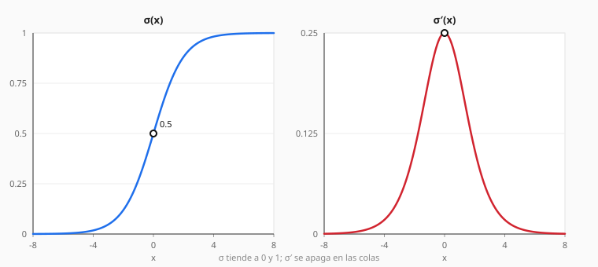

# sigmoid

## 1. Qué problema resuelve

Una neurona calcula $z = \sum_i w_i x_i + b$, que puede ser cualquier número real. Para que la red
pueda decidir y para poder encadenar capas hace falta una no linealidad acotada. La **sigmoid** (o
función logística) lleva $\mathbb{R}$ a $(0,1)$: se lee como probabilidad, es suave (derivable en todo
punto) y su derivada tiene forma cerrada, lo que abarata el descenso de gradiente. Fue la no linealidad
de la neurona clásica y sigue siendo la salida natural de un clasificador binario.

## 2. Definición y notación

$$\sigma(x) = \frac{1}{1 + e^{-x}}$$

- Dominio $\mathbb{R}$; imagen $(0,1)$: nunca toca 0 ni 1.
- $\sigma(0) = 1/2$.
- Simetría: $\sigma(-x) = 1 - \sigma(x)$.
- Límites: $\sigma(x)\to 0$ si $x\to -\infty$; $\sigma(x)\to 1$ si $x\to +\infty$.
- Inversa (logit): $\sigma^{-1}(p) = \ln\frac{p}{1-p}$.
- Derivada: $\sigma'(x) = \sigma(x)\,(1-\sigma(x))$, con máximo $1/4$ en $x=0$.

La curva tiende a 0 y 1 sin tocarlos; la derivada alcanza su máximo $1/4$ en $x=0$ y se apaga en las
colas: esa es la saturación.

## 3. Derivación

**Derivada.** Escribiendo $\sigma(x) = (1+e^{-x})^{-1}$ y aplicando la regla de la cadena:

$$\sigma'(x) = -(1+e^{-x})^{-2}\cdot(-e^{-x}) = \frac{e^{-x}}{(1+e^{-x})^2}.$$

Por otro lado,

$$\sigma(x)\,(1-\sigma(x)) = \frac{1}{1+e^{-x}}\cdot\frac{e^{-x}}{1+e^{-x}} = \frac{e^{-x}}{(1+e^{-x})^2}.$$

Las dos expresiones coinciden. □

**Simetría.**

$$\sigma(-x) = \frac{1}{1+e^{x}} = \frac{e^{-x}}{1+e^{-x}} = 1 - \frac{1}{1+e^{-x}} = 1-\sigma(x). \quad □$$

**Estabilidad numérica.** La forma directa evalúa $e^{-x}$; si $x$ es muy negativo, el argumento es
grande y el exponente se desborda. La forma por tramos evita ese desbordamiento:

$$\sigma(x) = \begin{cases} \frac{1}{1+e^{-x}} & x \ge 0 \\ \frac{e^{x}}{1+e^{x}} & x < 0 \end{cases}$$

En ambos casos el exponente es $\le 0$, así que $e^{\cdot}\in(0,1]$ y no hay desbordamiento.

## 4. Ejemplo a mano

| $x$ | $e^{-x}$ | $\sigma(x)$ | $\sigma'(x)$ |
| --- | --- | --- | --- |
| 0 | 1 | 0.5000 | 0.2500 |
| 1 | 0.3679 | 0.7311 | 0.1966 |
| -1 | 2.7183 | 0.2689 | 0.1966 |
| 4 | 0.0183 | 0.9820 | 0.0177 |

Para $x=1$: $\sigma(1) = 1/(1+0.3679) = 0.7311$ y
$\sigma'(1) = 0.7311 \times (1-0.7311) = 0.7311 \times 0.2689 = 0.1966$. El de $x=-1$ es el mismo por
simetría.

## 5. Implementación

- [`src/nn/sigmoid.ts`](../../src/nn/sigmoid.ts): `sigmoid(x)` y `sigmoidDerivative(x)` escalares, y
  `sigmoidTensor(tensor)`, que aplica σ elemento a elemento y, si el tensor pide gradiente, registra
  `σ(1−σ)`.
- [`test/nn/sigmoid.test.ts`](../../test/nn/sigmoid.test.ts): rango, monotonía, simetría, derivada
  numérica y saturación. El gradiente de la versión tensor se comprueba en `test/core/autograd.test.ts`.
- [`lab/sigmoid/run.ts`](../../lab/sigmoid/run.ts): tabla reproducible de $\sigma$ y $\sigma'$ frente a
  la derivada numérica.
- [`lab/sigmoid/plot.ts`](../../lab/sigmoid/plot.ts): genera la gráfica `sigmoid.svg` que acompaña a
  esta nota (σ y σ′ con la saturación).

## 6. Verificación

La derivada se comprueba con diferencias centrales:

$$\sigma'(x) \approx \frac{\sigma(x+h)-\sigma(x-h)}{2h}, \quad h=10^{-6}.$$

El error de truncamiento es $O(h^2)$ y el de redondeo $O(\varepsilon/h)$; la tolerancia razonable es
$10^{-8}$. Si la fórmula estuviera mal (un signo o un factor), el error sería del orden de
$\sigma'$, no de $10^{-9}$.

Además se verifica que:

- $\sigma(x)\in(0,1)$ y es estrictamente creciente.
- $\sigma(-x)+\sigma(x)=1$.
- $\sigma'(\pm 50) < 10^{-20}$ (saturación).
- No hay `NaN` ni `Infinity` en $x=\pm 1000$.
- El gradiente de `sigmoidTensor` es $\sigma(x)(1-\sigma(x))$, verificado contra la derivada numérica
  en el test de autograd.

## 7. Límites y errores comunes

- **Saturación.** $\sigma'\le 1/4$ y tiende a 0 en las colas. Apilar muchas sigmoids multiplica
  derivadas pequeñas y el gradiente se desvanece: una de las razones por las que las capas ocultas
  usan ReLU o tanh.
- **No está centrada en 0.** Sus salidas son positivas, lo que acopla el signo de los gradientes de
  los pesos; para capas ocultas suele preferirse una activación centrada.
- **En la salida binaria, con cross-entropy, no con MSE.** Con MSE y saturación el gradiente se
  aplana; con entropía cruzada la combinación se simplifica y entrena mejor.
- **Coste.** `exp` es más caro que `max(0, x)`; en redes grandes se nota.
- **Desbordamiento.** La forma ingenua desborda el exponente para $x$ muy negativo; la forma por
  tramos lo evita.
- **Multiclase.** Para más de dos clases no se usa sigmoid sino softmax (concepto de F2).

## 8. Mi explicación

Pendiente: la escribe la persona, sin mirar el resto de la nota.

## 9. Para profundizar (opcional)

- Goodfellow, Bengio y Courville, *Deep Learning*, cap. 6 (unidades ocultas).
- Nielsen, *Neural Networks and Deep Learning*, cap. 1 (gratuito en línea).
- La función logística aparece en Verhulst (1838) para el crecimiento de poblaciones.
