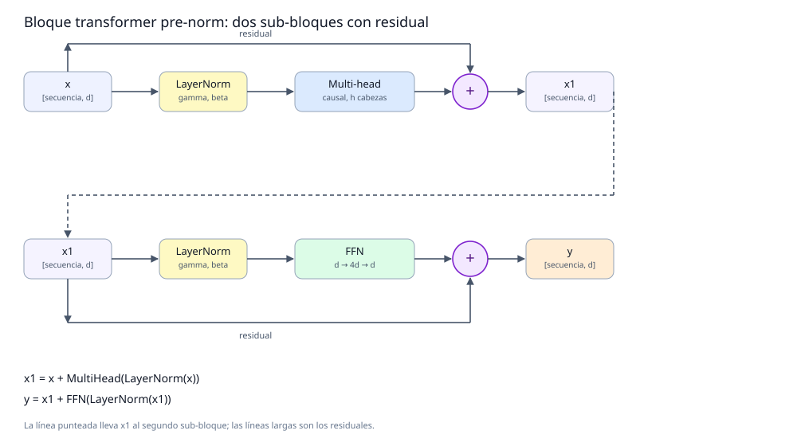

# Bloque transformer

## 1. Qué problema resuelve

Atención y FFN son piezas; el **bloque** las apila con residuales y normalización para que el
gradiente fluya y la escala no se descontrole. Es la unidad que se repite en un transformer.

## 2. Definición y notación

Un bloque **pre-norm**:

$$x_1 = x + \mathrm{MultiHead}(\mathrm{LayerNorm}(x)), \qquad y = x_1 + \mathrm{FFN}(\mathrm{LayerNorm}(x_1)).$$

**LayerNorm** por fila:

$$\mathrm{LN}(x) = \gamma \odot \frac{x - \mu}{\sqrt{\sigma^2 + \epsilon}} + \beta.$$

**FFN**: `Linear(d, 4d) → ReLU → Linear(4d, d)`.

- $\gamma, \beta$: parámetros por dimensión.
- El residual suma la entrada a la salida de cada sub-bloque.
- Pre-norm normaliza **antes** del sub-bloque; post-norm lo haría después.

## 3. Por qué funciona

- **Residual**: la identidad da una ruta directa al gradiente; el sub-bloque aprende un cambio, no la
  salida completa.
- **LayerNorm**: mantiene la escala por fila; sin ella, apilar bloques descontrola activaciones.
- **Pre-norm**: más estable para apilar muchos bloques; es la variante que se usa aquí.
- **FFN**: transforma cada posición por separado; la atención mezcla posiciones.

## 4. Ejemplo a mano

Entrada `[3, 4]`, dos cabezas, FFN oculto 8:

- LayerNorm: `[3, 4]`; atención: `[3, 4]`; residual: `[3, 4]`.
- LayerNorm: `[3, 4]`; FFN: `8 → 4`; residual: `[3, 4]`.
- 16 tensores de parámetros: 2 de cada LayerNorm, 8 de atención y 4 del FFN.
- En el laboratorio, la norma de la salida (4.91) es mayor que la de la entrada (2.45): el bloque
  transforma, no solo copia.

## 5. Implementación

- [`src/nn/layernorm.ts`](../../src/nn/layernorm.ts): `LayerNorm` con forward y backward propios
  (gamma, beta y epsilon).
- [`src/nn/feedforward.ts`](../../src/nn/feedforward.ts): `FeedForward` con dos `Linear` y ReLU.
- [`src/nn/transformer-block.ts`](../../src/nn/transformer-block.ts): `TransformerBlock` pre-norm con
  residuales y atención multi-cabeza.
- [`test/nn/layernorm.test.ts`](../../test/nn/layernorm.test.ts) y
  [`test/nn/transformer-block.test.ts`](../../test/nn/transformer-block.test.ts): normalización,
  gradcheck de gamma/beta y gradiente por todo el bloque.
- [`lab/attention/block.ts`](../../lab/attention/block.ts): un bloque sobre tres posiciones.

## 6. Verificación

- LayerNorm deja media ≈ 0 y varianza ≈ 1 por fila.
- El gradiente de entrada, gamma y beta coincide con diferencias finitas.
- La salida del bloque es `[3, 4]`, con dos matrices de atención causales.
- El gradiente llega a los 16 tensores y a la entrada.
- Cabezas que no dividen la dimensión y entradas inválidas fallan.
- 150/150 pruebas y `verify.mjs` en verde.

## 7. Límites y errores comunes

- **Un solo bloque**: el LM apilará varios.
- **Sin dropout** ni batch.
- **Pre-norm solamente**: no se compara con post-norm todavía.
- **Sin RoPE**: la posición llega en la siguiente pieza.
- **FFN con ReLU**: sin GELU/SwiGLU por ahora.

## 8. Mi explicación

Pendiente: la escribe la persona, sin mirar el resto de la nota.

## 9. Para profundizar (opcional)

- Vaswani et al. (2017), *Attention Is All You Need*.
- Xiong et al. (2020), *On Layer Normalization in the Transformer Architecture* (pre-norm vs post-norm).
- Documentación de `torch.nn.TransformerEncoderLayer`.
