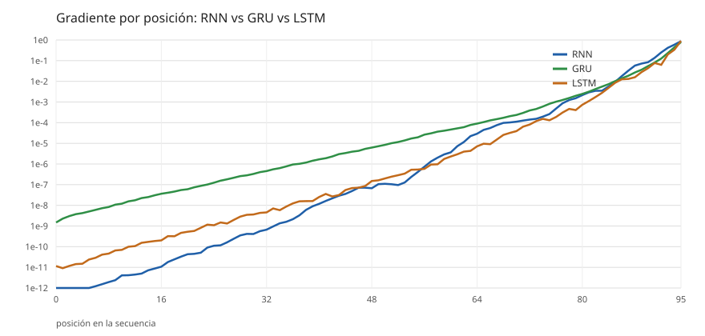

# GRU y LSTM

## 1. Qué problema resuelven

La RNN simple multiplica un jacobiano por paso; en secuencias largas el gradiente se desvanece y los
pasos lejanos no aprenden. **GRU** y **LSTM** añaden compuertas que controlan qué se guarda, qué se
olvida y qué se expone. No eliminan el problema, pero lo mitigan.

## 2. Definición y notación

**GRU**:

$$z = \sigma(x W_z + h U_z + b_z), \qquad r = \sigma(x W_r + h U_r + b_r)$$

$$n = \tanh(x W_n + (r \odot h) U_n + b_n), \qquad h' = (1-z)\odot n + z \odot h$$

**LSTM**:

$$i, f, o = \sigma(\cdot), \qquad g = \tanh(\cdot), \qquad c' = f \odot c + i \odot g, \qquad h' = o \odot \tanh(c')$$

- $\sigma$: sigmoid; cada compuerta vive en $(0,1)$.
- $\odot$: producto elemento a elemento.
- LSTM añade un **estado de celda** $c$ que se actualiza de forma aditiva.

## 3. Por qué ayudan

- La compuerta de olvido permite que $c$ conserve información durante muchos pasos sin multiplicarse
  por una matriz en cada uno.
- La suma $f \odot c + i \odot g$ da una ruta más directa al gradiente que el producto de $\tanh$.
- Siguen siendo recurrentes: si $f$ se queda pequeña, también olvidan; no son una garantía.

## 4. Comparación en el LM

Mismo texto, misma ventana de 32, mismos 3000 pasos y misma tasa (`0.05`); se mide la pérdida del
último paso de entrenamiento y la norma del gradiente en una ventana de 96 posiciones.

| Celda | Pérdida | Norma en posición 0 | Norma en posición 95 | Cociente |
| --- | --- | --- | --- | --- |
| RNN | 1.9707 | 2.84e−13 | 8.75e−1 | 3.24e−13 |
| GRU | 2.3948 | 1.48e−9 | 7.92e−1 | 1.87e−9 |
| LSTM | 2.6536 | 1.16e−11 | 9.05e−1 | 1.28e−11 |

Lectura:

- **Las compuertas mejoran el gradiente lejano**: la posición 0 pasa de 2.84e−13 (RNN) a 1.48e−9
  (GRU) o 1.16e−11 (LSTM). Son 4 y 2 órdenes de magnitud, respectivamente.
- **No lo eliminan**: a 96 pasos el gradiente del primer estado sigue siendo muchísimo menor que el
  del último.
- **A igual número de pasos, la RNN tiene menor pérdida**: 1.97 frente a 2.39 (GRU) y 2.65 (LSTM).
  Tiene menos parámetros y entrena más rápido; la comparación no es a igual tiempo ni a igual ajuste.
- **El texto generado sigue siendo de fragmentos** en las tres celdas: el problema no era solo la
  celda, también el tamaño, el contexto y el presupuesto.

## 5. Implementación

- [`src/nn/gru.ts`](../../src/nn/gru.ts): `GRU` con dos compuertas y candidato; `initial`/`advance`.
- [`src/nn/lstm.ts`](../../src/nn/lstm.ts): `LSTM` con tres compuertas y celda.
- [`src/nn/recurrent.ts`](../../src/nn/recurrent.ts): `RecurrentCell`/`RecurrentState` para que
  `CharLM` use la celda que se le pida.
- [`src/models/char-lm.ts`](../../src/models/char-lm.ts): opción `cell: "rnn" | "gru" | "lstm"`.
- [`lab/lm/cells.ts`](../../lab/lm/cells.ts): entrena las tres y dibuja la curva.

## 6. Verificación

- Las tres celdas tienen formas `[1, oculto]`, estado inicial en ceros y gradiente a todos sus pesos.
- `CharLM` entrena y genera con las tres.
- La tabla y la curva salen de la misma semilla, texto y presupuesto.
- 130/130 pruebas y `verify.mjs` en verde.

## 7. Límites y errores comunes

- **Misma tasa y mismos pasos**: no es una comparación de mejor ajuste posible.
- **Una sola semilla y un texto pequeño**.
- **96 posiciones**: con 300 o 500, las compuertas también se quedarían cortas.
- **Sin *gradient clipping* ni *schedules***.
- **Más parámetros no siempre es mejor con menos pasos**: GRU tiene 9 tensores y LSTM 12, frente a 3
  de la RNN.

## 8. Mi explicación

Pendiente: la escribe la persona, sin mirar el resto de la nota.

## 9. Para profundizar (opcional)

- Cho et al. (2014), *Learning Phrase Representations using RNN Encoder–Decoder* (GRU).
- Hochreiter y Schmidhuber (1997), *Long Short-Term Memory*.
- Goodfellow, Bengio y Courville, *Deep Learning*, cap. 10.
