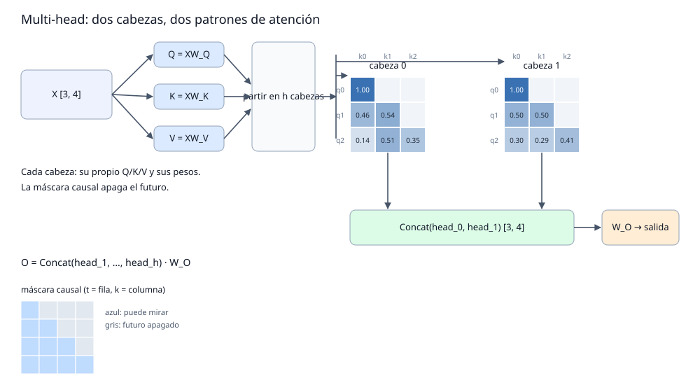

# Multi-head

## 1. Qué problema resuelve

Una sola atención produce una única mezcla de valores. Con **varias cabezas**, cada una puede
especializarse en una relación distinta: posición anterior, coincidencia de token, dependencia larga.
Multi-head es varias atenciones en paralelo sobre subespacios.

## 2. Definición y notación

- $d_{\text{model}}$: dimensión de la entrada y de la salida.
- $h$: número de cabezas; debe dividir $d_{\text{model}}$.
- $d_{\text{head}} = d_{\text{model}} / h$.

Pasos:

1. Proyectar la entrada con $W_Q, W_K, W_V$: $Q = XW_Q$, etc.
2. Partir $Q, K, V$ en $h$ trozos de $d_{\text{head}}$ columnas.
3. Aplicar atención escalada y causal en cada cabeza.
4. Concatenar las $h$ salidas y proyectar con $W_O$.

$$O = \mathrm{Concat}(\mathrm{head}_1, \dots, \mathrm{head}_h)\,W_O.$$

## 3. Por qué funciona

- Cada cabeza aprende una proyección distinta; el modelo no tiene que repartir una sola atención entre
  todas las relaciones.
- La concatenación vuelve a $d_{\text{model}}$; la proyección de salida mezcla las cabezas.
- El coste total sigue siendo $O(L^2 d_{\text{model}})$: se reparte la dimensión, no se multiplica.

## 4. Ejemplo a mano

Entrada `[3, 4]`, $h=2$, $d_{\text{head}}=2$:

- Q, K, V quedan `[3, 4]`.
- Cada cabeza atiende con matrices `[3, 2]`.
- Cada matriz de pesos es `[3, 3]`; la cabeza 0 y la 1 pueden dar patrones distintos.
- Al concatenar, la salida vuelve a `[3, 4]` y pasa por $W_O$.

En el laboratorio, la cabeza 0 y la 1 dan pesos distintos para las mismas posiciones: eso es lo que
aporta partir en cabezas.

## 5. Implementación

- [`src/nn/multihead.ts`](../../src/nn/multihead.ts): `MultiHeadAttention(modelSize, heads)` con cuatro
  `Linear` (Q, K, V, salida), `forward` y `parameters`.
- [`src/core/tensor-ops.ts`](../../src/core/tensor-ops.ts): `sliceColumns` y `concatColumns` con
  gradiente; son las operaciones que parten y juntan las cabezas.
- [`test/nn/multihead.test.ts`](../../test/nn/multihead.test.ts): formas, máscara, gradiente y
  validaciones.
- [`test/core/slices.test.ts`](../../test/core/slices.test.ts): gradiente de recorte y concatenación.
- [`lab/attention/multihead.ts`](../../lab/attention/multihead.ts): dos cabezas sobre tres posiciones.

## 6. Verificación

- La salida es `[3, 4]`; hay dos pesos `[3, 3]` con la triangularidad causal.
- Ocho tensores de parámetros (dos por cada `Linear`).
- El gradiente llega a la entrada y a todas las proyecciones.
- `dModel` no divisible por `heads`, cabezas no positivas y formas inválidas fallan.
- 144/144 pruebas y `verify.mjs` en verde.

## 7. Límites y errores comunes

- **Sin batch**: una secuencia.
- **Sin dropout** ni proyecciones separadas por cabeza.
- **Sin KV cache**: la generación recalcula todo.
- **Máscara causal fija** y sin máscara de padding.
- **Las cabezas deben dividir la dimensión**: si no, no hay trozos iguales.

## 8. Mi explicación

Pendiente: la escribe la persona, sin mirar el resto de la nota.

## 9. Para profundizar (opcional)

- Vaswani et al. (2017), *Attention Is All You Need* (multi-head).
- Documentación de `torch.nn.MultiheadAttention`.
