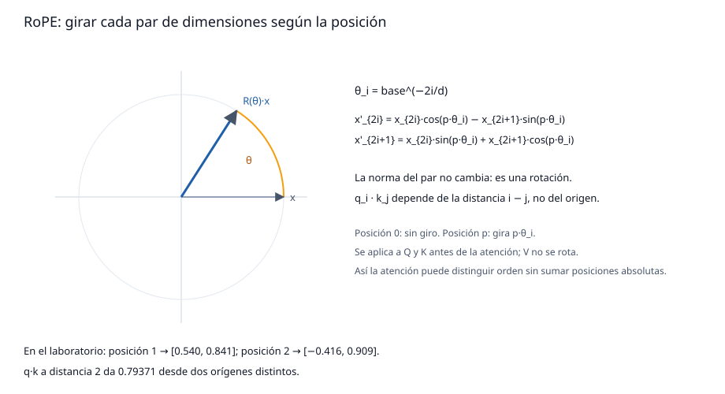

# RoPE

## 1. Qué problema resuelve

La atención pura es **permutación-invariante**: sin posición, «el perro muerde al hombre» y «el hombre
muerde al perro» son la misma bolsa de tokens. Sumar un embedding absoluto funciona, pero no dice nada
sobre la **distancia** entre dos tokens. RoPE rota Q y K según su posición; el producto $q_i \cdot k_j$
termina dependiendo de $i-j$.

## 2. Definición y notación

Para cada par de dimensiones $(2i, 2i+1)$ y una posición $p$:

$$\theta_i = \text{base}^{-2i/d}, \qquad x'_{2i} = x_{2i}\cos(p\theta_i) - x_{2i+1}\sin(p\theta_i),$$

$$x'_{2i+1} = x_{2i}\sin(p\theta_i) + x_{2i+1}\cos(p\theta_i).$$

- $\text{base} = 10000$ por defecto.
- Se aplica a **Q y K**, por cabeza, antes de la atención.
- $V$ no se rota.
- La posición 0 no gira nada.

## 3. Por qué funciona

- Es una **rotación**: conserva la norma del par y no hace crecer las activaciones.
- La rotación de $q$ en $i$ y $k$ en $j$ deja en el producto un factor que depende de $i-j$: la
  atención ve la **distancia relativa**, no solo la posición absoluta.
- No añade parámetros: no hay tabla de posiciones que entrenar.

## 4. Ejemplo a mano

Vector unitario $(1, 0)$ en dimensión 2, con $\theta_1 = 1$:

| Posición $p$ | $R(p)\cdot(1,0)$ |
| --- | --- |
| 0 | `[1.000, 0.000]` |
| 1 | `[0.540, 0.841]` |
| 2 | `[-0.416, 0.909]` |
| 3 | `[-0.990, 0.141]` |

Y $q\cdot k$ a distancia 2 da **0.79371** tanto desde la posición 3/5 como desde 0/2.

## 5. Implementación

- [`src/nn/rope.ts`](../../src/nn/rope.ts): `rope(tensor, { base, offset })` con forward y backward
  propios (la inversa de la rotación).
- [`src/nn/multihead.ts`](../../src/nn/multihead.ts): opción `rope: true`; se aplica a cada cabeza
  antes de `scaledDotProductAttention`.
- [`src/nn/transformer-block.ts`](../../src/nn/transformer-block.ts): pasa la opción `rope` al bloque.
- [`test/nn/rope.test.ts`](../../test/nn/rope.test.ts): norma, relatividad, gradcheck, multi-head con
  RoPE y validaciones.
- [`lab/attention/rope.ts`](../../lab/attention/rope.ts): posiciones y producto relativo.

## 6. Verificación

- La posición 0 no cambia el vector.
- La norma se conserva en cada fila.
- El producto a distancia 2 coincide desde dos orígenes distintos.
- El gradiente coincide con diferencias finitas.
- Multi-head con RoPE conserva formas y gradiente.
- 155/155 pruebas y `verify.mjs` en verde.

## 7. Límites y errores comunes

- **Dimensión par**: se rotan pares; una dimensión impar no tiene pareja.
- **Sin escalado de contexto**: no hay YaRN ni ajuste de `base` para contextos muy largos.
- **Offset manual**: para continuar una secuencia hay que pasar el desplazamiento; no hay KV cache.
- **Solo Q y K**: rotar V no tendría el mismo sentido.
- **Posiciones desde 0**: no hay convención de `<inicio>` todavía.

## 8. Mi explicación

Pendiente: la escribe la persona, sin mirar el resto de la nota.

## 9. Para profundizar (opcional)

- Su et al. (2021), *RoFormer: Enhanced Transformer with Rotary Position Embedding*.
- Documentación de RoPE en Llama/GPT-NeoX.
